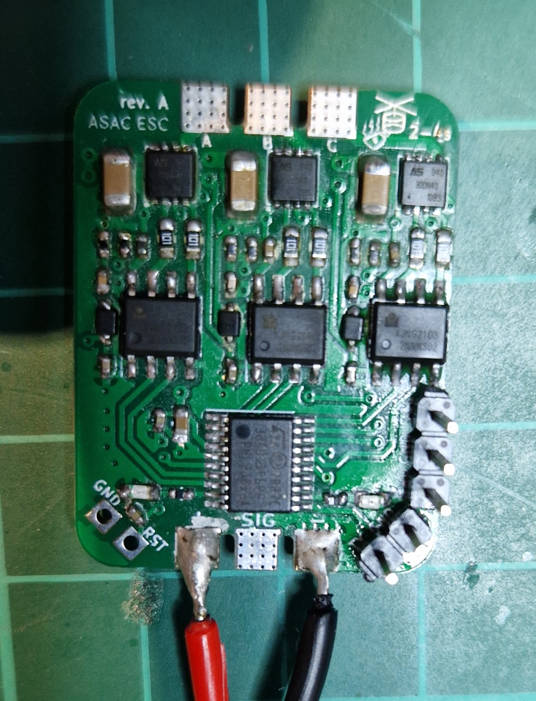
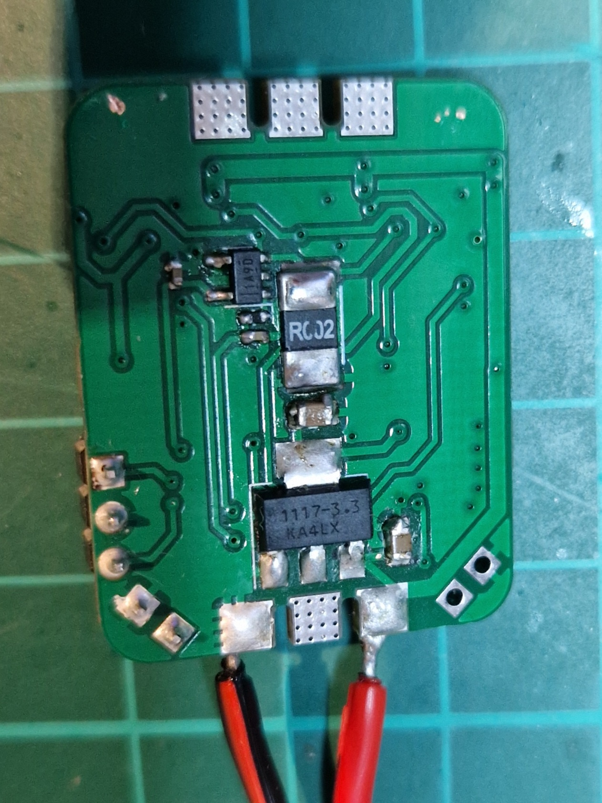
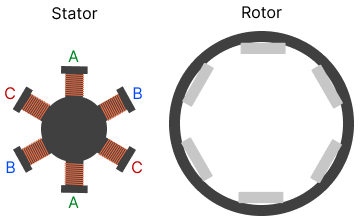
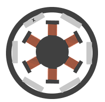
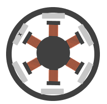
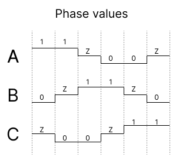
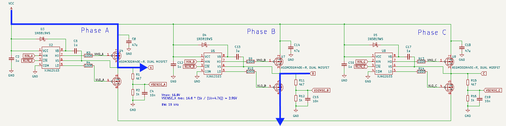
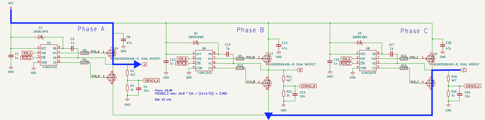
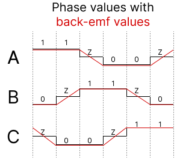
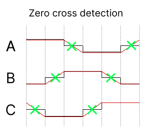

# asac esc

> 本文档为 [README.md](README.md) 的中文翻译版本。

**A** **S**imple **A**nd **C**ool **E**lectronic **S**peed **C**ontroller（asac esc，意为“一个简单又酷炫的电子调速器”）是一个开源的电子调速器（Electronic Speed Controller，ESC），同时包含硬件与软件。固件采用纯 C 语言编写。

## PCB Rev. A（第一版）

PCB 第一版迭代已完成。所有 CAD 文件可在 [kicad/asac-esc-rev-a](kicad/asac-esc-rev-a) 目录中找到，PDF 格式的原理图也在该目录中，或参见 [docs/asac-esc-rev-a.pdf](docs/asac-esc-rev-a.pdf)。





## asac esc 的工作原理

驱动无刷直流（brushless DC，BLDC）电机的方式是：每次只给其中一个线圈通电，通电线圈产生的磁场会作用于转子上的磁铁，从而推动转子转动。让转子前进“1 步”称为一次*换相（commutation）*。而让 BLDC 电机旋转起来并不复杂，无非就是反复给定子的各个线圈依次通电。换相的快慢决定了电机转速的高低，因此控制 BLDC 电机的转速，本质就是控制换相的速率。这可以通过控制流过线圈电流的大小来实现：电流越大，产生的磁场越强，换相就越快；反之则越慢。

#### 定子与转子（Stator and rotor）








#### 6 步换相（6-step commutation）

大多数（也许全部？）BLDC 电机的线圈数量都超过 3 个，但其中部分线圈在内部彼此相连，因此从电机中引出的线只有*三根*。我们可以把每一根线称为一*相（phase）*，即 A、B、C 三相。换相顺序由 6 个互不相同的状态组成，并不断循环。在这 6 个状态中的每一个里，都会有一相有电流流入，同时另一相有电流流出。要实现电流的流入和流出，可以借助半桥（half-bridge）结构中的 MOSFET：每一相需要一个半桥，因此总共需要 6 个 MOSFET。这种驱动 BLDC 电机的方式被称为*6 步换相*。

网上有大量详细介绍这一过程的优质资料，例如[这里](https://www.digikey.com/en/articles/how-to-power-and-control-brushless-dc-motors)。

下图描述了这 6 种不同的状态。图中做了一定的简化：“1”并不代表逻辑高电平，也不代表 1 V 电压，而仅仅表示该相允许电流流入；“0”表示电流从该相流出。MOSFET 实际上并不是由 1 和 0 直接驱动的，而是通过 PWM 控制，具体细节将在下文详述。“Z”表示该相处于悬空（floating）状态。



下面以前两个状态为例：状态 1 中电流流入 A 相、从 B 相流出；状态 2 中电流流入 A 相、从 C 相流出。

换相状态 1 —— 电流流入 **A** 相，从 **B** 相流出。


换相状态 2 —— 电流流入 **A** 相，从 **C** 相流出。



状态 3～6 依此类推……

#### BEMF 闭环控制（BEMF closed-loop control）

虽然 BLDC 电机*不*带任何反馈也能运行，但这种运行方式只能工作在受限的转速下，因为我们没有任何途径得知转子的位置。如果转子位置未知，就无法精确判断应该在*何时*开启某一相。而要判断“何时进行下一次换相”，可以通过检测第三相（“未使用”的悬空相）中感应出的反电动势（back electromotive force，BEMF）来实现。在前面的原理图中可以看到，每一相都通过分压电阻网络连接了一个 “VSENSE_X” 信号，该信号将接到微控制器的 ADC 上。

BEMF 的电压变化（大致）遵循下图所示的规律：



假设我们正处于状态 3，此时 A 相刚刚被关断并处于悬空状态。该相的电压仍然较高，但过一段时间后会回落到零。这里的技巧在于：我们需要检测这段下降坡道的中点，以便安排下一次换相。这个“中点”被称为*过零点（zero cross）*。请注意，过零点并不真的在 0 V，而是最高电压与零之间的中点，因此 `zero_cross = vmax / 2`。要实现这一点，我们必须知道当前处于哪个换相状态，因为 BEMF 值的变化方向（上升/下降）会随状态的不同而改变。每个更新循环中都会对 BEMF 的 ADC 采样值进行采样，以检测 BEMF 值何时越过过零点。



将 BEMF 作为判断换相时机的输入，这种运行方式被称为*闭环（closed-loop）*。

那么在代码中是如何实现的呢？半桥中连接高压侧（high side）的 MOSFET 会被导通以允许电流通过，低压侧（low side）的 MOSFET 则被驱动到低电平，使电流经其流向地。注意，高压侧的 MOSFET 由 PWM 信号驱动，从而可以控制流过线圈的电流大小。PWM 信号的频率取决于所用电机，而 asac esc 的 PWM 频率为 24 kHz（实际为 23437.5 Hz），占空比分辨率为 2048。PWM 越大意味着电流越大 -> 磁场越强 -> 换相越快。

一旦检测到过零点，下一次换相就会被安排在检测时刻之后约半个换相周期处。这个换相周期时长取自上一个换相周期。需要注意的是，更新循环、滤波等造成的延迟会被扣除，因此实际上，下一次换相被安排在类似这样的时间点：

```
if (zero_cross_detected)
{
    next_commutation = now + half_commutation_period - filter_delay - update_delay
}
```

#### 启动阶段（Start-up phase）

利用反电动势来判断何时切换到下一个换相状态有一个问题：在电机开始旋转之前，我们完全不知道转子的位置。解决这个问题的方法是让电机以*开环（open-loop）*模式启动旋转，即以*固定*的周期依次遍历换相状态。在此期间仍会持续观测反电动势，以判断何时可以切换到闭环模式。判断的依据是：是否检测到了一个在“合理”时间内出现的过零点。所谓“合理”时间，我指的是过零点大致在一个换相周期的中间被检测到。

#### 输入信号（Input signal）

asac esc 支持标准输入信号，例如：

- 50 Hz（1000-2000 μs）

以上信号均以脉冲形式给出，脉冲宽度与油门值成正比。

脉冲通过引脚上的中断进行检测。
